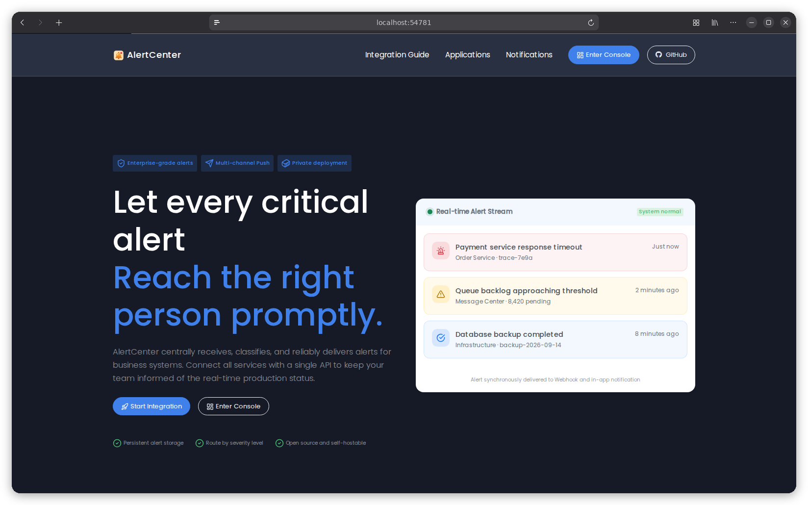

# AlertCenter

[](./LICENSE)
[](https://gitlab.aiursoft.com/aiursoft/alertcenter/-/pipelines)
[](https://gitlab.aiursoft.com/aiursoft/alertcenter/-/pipelines)
[](https://s360.aiursoft.com/SupplyChain?tab=projects&project=aiursoft%2Falertcenter&scope=baseline&ecosystem=all)
[](https://manhours.aiursoft.com/r/github.com/aiursoftweb/alertcenter.html)
[](https://hub.docker.com/r/aiursoft/alertcenter)

AlertCenter is a self-hosted alert management and notification platform built on ASP.NET Core (.NET 10). Business systems create incidents through one HTTP API; teams manage incidents, on-call schedules, and delivery through Webhook, email, and in-app notifications.



On an empty database, the default local account is `admin@default.com` with password `Admin@123456!`. Change the password before exposing the application.

## What is AlertCenter?

- Independent API keys, idempotent reporting, and five severity levels (`sev0` through `sev4`).
- Independent incidents, acknowledgement, ownership, mitigation, resolution, and Markdown discussions.
- On-call teams, reusable scheduling rules, and an interactive schedule editor with overlap and rest validation.
- Severity-based notification routing, personal inboxes, and delivery history.
- Application owners grant users and roles access to incidents, API keys, and application settings. Platform permissions control application creation and shared on-call/push administration; application managers can bind any visible on-call team.
- SQLite for standalone use, MySQL support, and local or OIDC authentication through [Aiursoft Template](https://github.com/AiursoftWeb/template).

## Install with Docker

Run the installer with the desired port (omit it to choose an available port):

```bash
curl -fsSL https://raw.githubusercontent.com/aiursoftweb/alertcenter/master/install.sh | sudo bash -s -- 8080
```

Installation starts after three seconds; press Ctrl+C to cancel. Then open `http://localhost:8080`.

## Run manually

1. Install the .NET 10 SDK and Node.js/npm.
2. Prepare the frontend assets:

   ```bash
   npm ci --prefix src/Aiursoft.AlertCenter/wwwroot
   npm run build --prefix src/Aiursoft.AlertCenter/wwwroot
   ```

3. Start the application:

   ```bash
   dotnet run --project src/Aiursoft.AlertCenter
   ```

4. Open the URL printed by the application.

The defaults use SQLite and local accounts. Configure authentication, database, and storage through [appsettings.json](src/Aiursoft.AlertCenter/appsettings.json) or environment variables.

## Run in Microsoft Visual Studio

1. Prepare the frontend assets as described above.
2. Open `Aiursoft.AlertCenter.sln` and run the `Aiursoft.AlertCenter` project with `F5`.

## Run in Docker

```bash
image=aiursoft/alertcenter
appName=alertcenter
sudo docker pull $image
sudo docker run -d --name $appName --restart unless-stopped -p 5000:5000 -v /var/www/$appName:/data $image
```

Open `http://localhost:5000`. Keep `/data` persistent for configuration, the SQLite database, uploaded files, and Data Protection keys.

| Properties | Value |
| --- | --- |
| Image | aiursoft/alertcenter |
| Ports | 5000 |
| Binary path | /app |
| Data path | /data |
| Config path | /data/appsettings.json |

The image copies its default configuration to `/data/appsettings.json` on first start and retains that file on subsequent starts. Environment variables use double underscores, such as `ConnectionStrings__DefaultConnection` or `AppSettings__OIDC__ClientSecret`.

## Integrations

Create an application and API key in the web UI. Its **Integration Guide** provides HTTP API examples for your server.

A .NET SDK and command-line client are also available:

```bash
dotnet add package Aiursoft.AlertCenter.SDK
dotnet tool install --global Aiursoft.AlertCenter.Client
```

The CLI can query and manage incidents, update metadata, and report GitLab pipeline results. Pass `--server` and `--api-key` with each command; use `alertcenter --help` to explore commands.

## Permissions and on-call response

Platform capabilities use `Permission` claims. Roles collect permissions; the name `Administrators` does not grant privileges by itself.

- `CanManageApplications` permits creating applications. It does not bypass per-application ownership or user/role grants.
- `CanManageOnCall` permits managing teams, scheduling rules, and schedules. Saved shifts determine the current on-call engineers (OCEs); a rule preview alone does not provide coverage.
- `CanManagePush` permits managing channels and sensitive delivery configuration. A user's channel binding access and recipient membership are separate; binding a channel also requires application manage access.

Only the application owner or users explicitly granted incident update permission may handle an incident. OCE duty and incident assignment do not grant access. A view grant alone does not permit incident handling. Default identity initialization runs only when both users and roles are empty; restarting an existing installation does not restore revoked permissions or grant newly introduced permissions.

Applications may bind an on-call team. Each new incident queues built-in email to that team's OCEs at `OccurredAtUtc`, independently of custom severity routes. The initial OCE roster and email addresses are snapshotted; later incident emails retain those recipients even after shift, membership, address or application team changes. Team CC configuration applies regardless of the shift and is captured for each delivery; retries retain that delivery’s recipient and CC snapshot. If the original group has been deleted, its captured CC list is retained. Correcting CC configuration permits later emails when the original OCE addresses are valid; failed delivery history and invalid original OCE addresses are not rewritten. The incident page shows this original roster separately from the current OCEs. ACK assigns the owner without changing the roster. Historical incidents without an original snapshot do not substitute the current OCE; when an on-call team is configured, a visible failed delivery explains the missing snapshot. Missing coverage or invalid recipient configuration produces a visible delivery failure without rejecting the alert. There are no automatic email retries; inspect delivery records before manually retrying an SMTP failure.

## Configuration

See the comments in [appsettings.json](src/Aiursoft.AlertCenter/appsettings.json) for database, storage, authentication, and logging settings. Keep secrets in protected environment variables.

- **OIDC:** set `AppSettings__AuthProvider=OIDC` and the `AppSettings__OIDC__*` values. Register the application's HTTPS `/signin-oidc` callback with your identity provider and assign the required application permissions.
- **Email:** configure `Email__Host`, `Email__Port`, `Email__From`, and, when required, `Email__UserName` and `Email__Password`. STARTTLS is enabled by default. Both custom channels and built-in on-call email use these settings. Emails include HTML and plain-text alternatives with a direct incident link. Incident email is sent for creation (red), mitigation (yellow), resolution (green), and reopening (red). Each successful transition queues an email, including repeated mitigation and resolution after reopening. Mitigate-and-resolve sends only the green resolution email. Acknowledgement, reassignment, comments, and severity changes do not send email; API resolution follows the same rules. Set `Email__PublicBaseUrl` to your public site address (including any path prefix); it defaults to `https://alertcenter.aiursoft.com`.
- **Webhook:** custom encrypted request headers require `Webhook__HeaderProtectionKey`, a Base64-encoded 32-byte key generated with `openssl rand -base64 32`. Preserve this key: losing or changing it makes saved custom headers unreadable. Without it, default headers and custom JSON body templates remain available.

### Database migrations

The multiple-key migration removes the old application-level secret hash without migrating credentials. Create new scoped keys and update integration configuration after upgrading. EmployeeCenter audit synchronization needs query, create and resolve permissions.

The application applies pending migrations at startup. Generate future migrations for both providers using the [SQLite guide](src/Aiursoft.AlertCenter.Sqlite/HOW_TO_ADD_MIGRATIONS.md) and [MySQL guide](src/Aiursoft.AlertCenter.MySql/HOW_TO_ADD_MIGRATIONS.md).

## How to contribute

Report bugs and suggestions through the issue tracker. Create a fork and a feature branch, then submit a merge request for review.

After preparing frontend assets, run the existing checks:

```bash
dotnet test tests/Aiursoft.AlertCenter.Tests.csproj
node --test tests/Frontend/*.test.cjs
./lint.sh
```

### Application sharing

An application owner has every application permission. Sharing grants independent permissions to users or roles: view, create, update incidents (including comments and status), manage API keys, permanently delete incidents, and manage application settings/sharing. Direct and role grants are combined. Updating or deleting incidents also requires view access. Application creation uses the existing platform permission; platform permissions, incident assignment, and on-call duty do not grant access to another application's incidents.

Only the owner can transfer ownership or delete the application. Sharing managers cannot grant permissions they do not have. Permanent incident deletion requires its exact title and current version. Existing explicit view/manage grants are preserved by the migration; older applications have no inferred owner and need an explicit ownership assignment before owner-only operations. Owner accounts must transfer their applications before deletion.

Each application owns multiple API keys. Owners and users/roles granted API key management can list, create, edit and delete its keys; newly granted key permissions cannot exceed the manager's application permissions. Keys authenticate as `<applicationId>.<keyId>.<secret>` and cannot access another application. The key list shows persistent authenticated-call totals and last-use timestamps (UTC). Counts include permission denials and business failures after valid input/authentication, but exclude malformed requests and invalid credentials.

Applications can change an active incident severity through `POST /api/v1/incidents/{incidentId}/severity` or SDK `ChangeIncidentSeverityAsync`. Supply the queried `Version`, a `Level` from `sev0` to `sev4`, and a `Reason`. This requires the separate **Change incident severity** API key scope (disabled on existing keys). Changes are application-scoped, concurrency-checked and recorded in the timeline without sending email. SDK version: `10.3.0`.

SDK 10.8.0 adds `ReopenIncidentAsync` (`POST /api/v1/incidents/{incidentId}/reopen`) with the independent **Reopen incidents** key scope, disabled on existing keys. Supply the queried `Version` and a `Reason`; query/detail responses include `MitigatedAtUtc` and `ResolvedAtUtc`. Set `RecoveredSinceUtc` to query open incidents plus recovery history since a UTC cutoff.

Acknowledgement is independent of incident progress (`new`, `mitigated`, `resolved`).
Any authorized user may acknowledge repeatedly; each acknowledgement assigns the
incident to that user without changing its progress. `AcknowledgedAtUtc` is the
latest acknowledgement time, and `IsAcknowledged` reports whether it has ever
been acknowledged. Reopening preserves acknowledgement and ownership. SDK 10.6.0
query/detail responses also expose these fields and the current owner. Legacy
`status=acked` web links select acknowledged incidents across all progress states;
use `acknowledged=true` or `false` to combine confirmation with a progress filter.

The dashboard links to **My incidents** (`/Incidents/Mine`), showing incidents whose current owner is the signed-in user, within that user's accessible applications. Status, severity, acknowledgement, keyword and date filters remain available; pagination retains the personal scope. Ownership does not grant application access.
