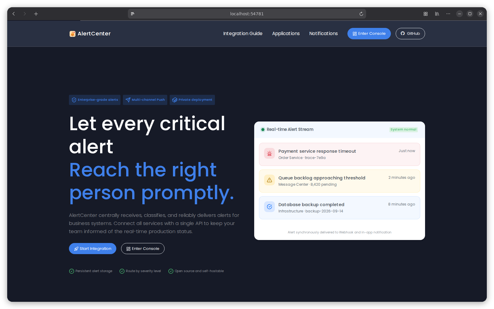

# Aiursoft AlertCenter

<a name="alertcenter"></a>

[](./LICENSE)
[](https://gitlab.aiursoft.com/aiursoft/alertcenter/-/pipelines)
[](https://gitlab.aiursoft.com/aiursoft/alertcenter/-/pipelines)
[](https://s360.aiursoft.com/SupplyChain?tab=projects&project=aiursoft%2Falertcenter&scope=baseline&ecosystem=all)
[](https://manhours.aiursoft.com/r/github.com/aiursoftweb/alertcenter.html)
[](https://hub.docker.com/r/aiursoft/alertcenter)

AlertCenter is a self-hosted alert management and notification platform built on ASP.NET Core (.NET 10). Business systems create incidents through one HTTP API; teams manage incidents, on-call schedules, and delivery through Webhook, email, and in-app notifications.



On an empty database, the default local account is `admin@default.com` with password `Admin@123456!`. Change the password before exposing the application.

## Overview

### What is AlertCenter?

- Independent API keys, idempotent reporting, and five severity levels (`sev0` through `sev4`).
- Independent incidents, acknowledgement, ownership, mitigation, resolution, and Markdown discussions.
- On-call teams, reusable scheduling rules, and an interactive schedule editor with overlap and rest validation.
- Severity-based notification routing, personal inboxes, and delivery history.
- Application owners grant users and roles access to incidents, API keys, and application settings. Platform permissions control application creation and shared on-call/push administration; application managers can bind any visible on-call team.
- SQLite for standalone use, MySQL support, and local or OIDC authentication through [Aiursoft Template](https://github.com/AiursoftWeb/template).

## CLI & SDK

### CLI

Install the CLI with the [.NET 10 SDK](https://dotnet.microsoft.com/download/dotnet/10.0):

```bash
dotnet tool install --global Aiursoft.AlertCenter.Client
```

Update an existing installation:

```bash
dotnet tool update --global Aiursoft.AlertCenter.Client
```

Remove the CLI:

```bash
dotnet tool uninstall --global Aiursoft.AlertCenter.Client
```

Run `alertcenter --help` to explore commands.

See [Integrations](#integrations) for authentication and usage.

### SDK

Add the SDK to your .NET project:

```bash
dotnet add package Aiursoft.AlertCenter.SDK
```

### Android app

A native Android client supports incident browsing and response. See [Android app](https://github.com/aiursoftweb/alertcenter/blob/master/docs/android.md) for authentication, building and installation.

## Install with Docker

Run the installer with the desired port (omit it to choose an available port):

```bash
curl -fsSL https://raw.githubusercontent.com/aiursoftweb/alertcenter/master/install.sh | sudo bash -s -- 8080
```

Installation starts after three seconds; press Ctrl+C to cancel. Then open `http://localhost:8080`.

## Run manually

Requirements about how to run

1. Install [.NET 10 SDK](https://dotnet.microsoft.com/download/dotnet/10.0) and [Node.js](https://nodejs.org/).
2. The .NET build automatically runs `npm ci` and `npm run build` to prepare the frontend assets. Node.js and npm must be available when building from source.
3. Execute `dotnet run --project src/Aiursoft.AlertCenter/Aiursoft.AlertCenter.csproj -- --urls http://localhost:5000` to run the app.
4. Use your browser to view [http://localhost:5000](http://localhost:5000).

## Run in Microsoft Visual Studio

1. Install the requirements described above; the build prepares the frontend assets.
2. Open `Aiursoft.AlertCenter.sln`, select `Aiursoft.AlertCenter` as the startup project, and press `F5`.

## Run in Docker

First, install Docker [here](https://docs.docker.com/get-docker/).

Then run the following commands in a Linux shell:

```bash
image=aiursoft/alertcenter
appName=alertcenter
sudo docker pull $image
sudo docker run -d --name $appName --restart unless-stopped -p 5000:5000 --mount type=volume,source=$appName-data,target=/data $image
```

That will start a web server at `http://localhost:5000` and you can test the app.

The docker image has the following context:

| Properties  | Value                           |
|-------------|---------------------------------|
| Image       | aiursoft/alertcenter               |
| Ports       | 5000                            |
| Binary path | /app                            |
| Data path   | /data                           |
| Config path | /data/appsettings.json          |

Keep `/data` persistent for configuration, the SQLite database, uploaded files and Data Protection keys. To use a host directory instead of the named volume, replace the mount argument with `-v /var/www/$appName:/data`.

## Usage

### Integrations

Create an application and API key in the web UI. Its **Integration Guide** provides HTTP API examples for your server.

Install the CLI or SDK using the [commands above](#cli--sdk).

The CLI can query and manage incidents, update metadata, and report GitLab pipeline results. Pass `--server` and `--api-key` with each command; use `alertcenter --help` to explore commands.

### Permissions and on-call response

Platform capabilities use `Permission` claims. Roles collect permissions; the name `Administrators` does not grant privileges by itself.

- `CanManageApplications` permits creating applications. It does not bypass per-application ownership or user/role grants.
- `CanManageOnCall` permits managing teams, scheduling rules, and schedules. Saved shifts determine the current on-call engineers (OCEs); a rule preview alone does not provide coverage.
- `CanManagePush` permits managing channels and sensitive delivery configuration. A user's channel binding access and recipient membership are separate; binding a channel also requires application manage access.

Only the application owner or users explicitly granted incident update permission may handle an incident. OCE duty and incident assignment do not grant access. A view grant alone does not permit incident handling. Default identity initialization runs only when both users and roles are empty; restarting an existing installation does not restore revoked permissions or grant newly introduced permissions.

Applications may bind an on-call team. Each new incident queues built-in email to that team's OCEs at `OccurredAtUtc`, independently of custom severity routes. The initial OCE roster and email addresses are snapshotted; later incident emails retain those recipients even after shift, membership, address or application team changes. Team CC configuration applies regardless of the shift and is captured for each delivery; retries retain that delivery’s recipient and CC snapshot. If the original group has been deleted, its captured CC list is retained. Correcting CC configuration permits later emails when the original OCE addresses are valid; failed delivery history and invalid original OCE addresses are not rewritten. The incident page shows this original roster separately from the current OCEs. ACK assigns the owner without changing the roster. Historical incidents without an original snapshot do not substitute the current OCE; when an on-call team is configured, a visible failed delivery explains the missing snapshot. Missing coverage or invalid recipient configuration produces a visible delivery failure without rejecting the alert. There are no automatic email retries; inspect delivery records before manually retrying an SMTP failure.

### Application sharing

An application owner has every application permission. Sharing grants independent permissions to users or roles: view, create, update incidents (including comments and status), manage API keys, permanently delete incidents, and manage application settings/sharing. Direct and role grants are combined. Updating or deleting incidents also requires view access. Application creation uses the existing platform permission; platform permissions, incident assignment, and on-call duty do not grant access to another application's incidents.

Only the owner can transfer ownership or delete the application. Sharing managers cannot grant permissions they do not have. Permanent incident deletion requires its exact title and current version. Existing explicit view/manage grants are preserved by the migration; older applications have no inferred owner and need an explicit ownership assignment before owner-only operations. Owner accounts must transfer their applications before deletion.

Each application owns multiple API keys. Owners and users/roles granted API key management can list, create, edit and delete its keys; newly granted key permissions cannot exceed the manager's application permissions. Keys authenticate as `<applicationId>.<keyId>.<secret>` and cannot access another application. The key list shows persistent authenticated-call totals and last-use timestamps (UTC). Counts include permission denials and business failures after valid input/authentication, but exclude malformed requests and invalid credentials.

Applications can change an active incident severity through `POST /api/v1/incidents/{incidentId}/severity` or SDK `ChangeIncidentSeverityAsync`. Supply the queried `Version`, a `Level` from `sev0` to `sev4`, and a `Reason`. This requires the separate **Change incident severity** API key scope (disabled on existing keys). Changes are application-scoped, concurrency-checked and recorded in the timeline without sending email. SDK version: `10.3.0`.

SDK 10.8.0 adds `ReopenIncidentAsync` (`POST /api/v1/incidents/{incidentId}/reopen`) with the independent **Reopen incidents** key scope, disabled on existing keys. Supply the queried `Version` and a `Reason`; query/detail responses include `MitigatedAtUtc` and `ResolvedAtUtc`. Set `RecoveredSinceUtc` to query open incidents plus recovery history since a UTC cutoff.

Acknowledgement is independent of incident progress (`new`, `mitigated`, `resolved`).
Any authorized user may acknowledge repeatedly; each acknowledgement assigns the
incident to that user without changing its progress. `AcknowledgedAtUtc` is the
latest acknowledgement time, and `IsAcknowledged` reports whether it has ever
been acknowledged. Reopening preserves acknowledgement and ownership. SDK 10.6.0
query/detail responses also expose these fields and the current owner. Legacy
`status=acked` web links select acknowledged incidents across all progress states;
use `acknowledged=true` or `false` to combine confirmation with a progress filter.

The dashboard links to **My incidents** (`/Incidents/Mine`), showing incidents whose current owner is the signed-in user, within that user's accessible applications. Status, severity, acknowledgement, keyword and date filters remain available; pagination retains the personal scope. Ownership does not grant application access.

### Database migrations

The multiple-key migration removes the old application-level secret hash without migrating credentials. Create new scoped keys and update integration configuration after upgrading. EmployeeCenter audit synchronization needs query, create and resolve permissions.

The application applies pending migrations at startup. Generate future migrations for both providers using the [SQLite guide](https://github.com/aiursoftweb/alertcenter/blob/master/src/Aiursoft.AlertCenter.Sqlite/HOW_TO_ADD_MIGRATIONS.md) and [MySQL guide](https://github.com/aiursoftweb/alertcenter/blob/master/src/Aiursoft.AlertCenter.MySql/HOW_TO_ADD_MIGRATIONS.md).

## Configuration

<a name="configuration-guide"></a>

The defaults run as a standalone application with SQLite, local accounts, local file storage, and no ClickHouse server. Change a setting only after preparing the dependency named in its comment.

The Docker image copies this file to `/data/appsettings.json` on its first start and keeps that copy on later starts. Mount `/data` as a persistent volume. To override a value without editing the file, use an environment variable with double underscores, such as `Storage__Path` or `AppSettings__OIDC__ClientSecret`.

```jsonc
{
  "ConnectionStrings": {
    // True: cache EF Core query results in this process. False: read from the database on every query.
    "AllowCache": "True",

    // Sqlite: use a local database file and no database server. MySql: use an external MySQL server.
    // When changing this value, also replace DefaultConnection with a connection string for that provider.
    "DbType": "Sqlite",
    // With Sqlite, this creates app.db in the process working directory and applies migrations at startup.
    "DefaultConnection": "DataSource=app.db;Cache=Shared"

    // MySql requires a reachable server, database, user, and password. The application applies migrations at startup.
    // sudo docker run -d --name db -e MYSQL_RANDOM_ROOT_PASSWORD=true -e MYSQL_DATABASE=template -e MYSQL_USER=template -e MYSQL_PASSWORD=template_password -p 3306:3306 hub.aiursoft.com/mysql
    //"DbType": "MySql",
    //"DefaultConnection": "Server=localhost;Database=template;Uid=template;Pwd=template_password;"
  },
  "Storage": {
    // Writable local directory for public Workspace files and token-protected private Vault files.
    // This is not an S3 or MinIO bucket.
    // The Docker image changes /tmp/data to /data; mount /data as a persistent volume in production.
    "Path": "/tmp/data",

    // Optional second hostname for this application's own /download endpoints; this is not an S3 or MinIO URL.
    // Example: set https://files.example.com, point that DNS name to this server, and add this Caddy route:
    // files.example.com {
    //     reverse_proxy 127.0.0.1:5000
    // }
    // Replace 127.0.0.1:5000 with the same upstream used by the web UI. Leave empty to use the UI hostname.
    "PublicOrigin": "",

    // False: verified images and configured media can open on the normal web hostname.
    // True: inline viewing works only through PublicOrigin; the same request on the UI hostname downloads the file.
    // True requires PublicOrigin plus DNS, TLS, and a reverse-proxy route to this same application instance.
    "RequireDedicatedInlineOrigin": false,

    // False: only verified images and SafeInlineMediaExtensions open in the browser; every other file downloads.
    // True: every file type may open through PublicOrigin, and HTML or SVG scripts may run there.
    // True requires RequireDedicatedInlineOrigin=true and a PublicOrigin that receives no application cookies.
    "AllowArbitraryInlineOnDedicatedOrigin": false,

    // File extensions allowed to open after content-signature validation. Empty means no extra audio, video, or SVG.
    // Supported values are mp3, mp4, ogg, svg, wav, and webm. This does not grant upload permission.
    "SafeInlineMediaExtensions": ["svg"],

    // SVG opens only when svg is enabled above and its Workspace path starts with an entry in this list.
    // Example: [ "markdown-images" ]. Empty means every SVG downloads.
    "SafeInlineSvgSubfolders": ["project-logo"],

    // These values are copied into newly issued signed upload tokens; existing tokens keep their old policy.
    "UploadPolicy": {
      // False: a valid signed upload token is enough. True: the uploader must also be signed in to this application.
      "RequireAuthenticatedUser": false,

      // False: preserve spaces in uploaded file names. True: save each space as a hyphen.
      "ReplaceSpacesWithHyphens": false
    }
  },
  "Webhook": {
    // Optional 32-byte Base64 key for encrypting custom Webhook headers. Set through Webhook__HeaderProtectionKey; do not save a real key here.
    "HeaderProtectionKey": ""
  },
  "Email": {
    // Public site address used for links in background email notifications.
    "PublicBaseUrl": "https://alertcenter.aiursoft.com",
    // SMTP host, port, sender, and optional credentials. Set Email__Password through a protected environment variable; do not save a real password here.
    "Host": "",
    "Port": 587,
    "UserName": "",
    "Password": "",
    "From": "",
    // True uses STARTTLS. The SMTP server must support it.
    "RequireTls": true
  },
  "AppSettings": {
    // Local: use built-in accounts and passwords. OIDC: redirect sign-in to an external identity provider.
    // OIDC also requires the OIDC section below and a provider callback URL of https://<web-host>/signin-oidc.
    "AuthProvider": "Local",

    // Empty: assign no automatic role. Otherwise, assign this role to every new local or OIDC user.
    // With Local, create the role first. With OIDC, the application creates it during account synchronization.
    "DefaultRole": "",

    // False: sign-in ends when the browser session closes. True: issue a persistent sign-in cookie.
    "PersistsSignIn": false,

    // This section is used only when AuthProvider is OIDC.
    "OIDC": {
      // Provider discovery base URL. It must be reachable by the application and should use HTTPS in production.
      "Authority": "https://auth.aiursoft.com/application/o/template",
      // Client identifier created for this application in the OIDC provider.
      "ClientId": "",
      // Client secret created by the provider. Set AppSettings__OIDC__ClientSecret instead of committing a real secret.
      "ClientSecret": "",
      "MobileAuthority": "",
      "MobileClientId": "alertcenter-android",
      "MobileRedirectUri": "com.aiursoft.alertcenter:/oauth2redirect",
      "ApiAudience": "alertcenter-android",
      "ApiScope": "",
      "RequireHttpsMetadata": true,

      // Claim containing role names. On every login, local roles are replaced by these roles plus DefaultRole.
      "RolePropertyName": "groups",
      // Required claim used as the local username when an OIDC account is first created.
      "UsernamePropertyName": "preferred_username",
      // Required claim copied to the local display name on every login.
      "UserDisplayNamePropertyName": "name",
      // Required unique email claim. The provider must keep it verified, unique, and stable.
      "EmailPropertyName": "email",
      // Required immutable account identifier. Keep this mapped to the standard OIDC sub claim.
      "UserIdentityPropertyName": "sub"
    },

    // This section is used only when AuthProvider is Local.
    "Local": {
      // True: show self-registration and allow new local accounts. False: existing users can sign in, but cannot register.
      "AllowRegister": true,
      // True: require only six characters. False: require eight characters with upper, lower, digit, and symbol.
      "AllowWeakPassword": true
    }
  },
  "GlobalSettings": {
    // Leave an entry commented to use the database value or built-in default.
    // Uncommenting an entry forces that value and overrides changes made in the administration UI.

    // True: users may change their display nickname. False: only administrators control it.
    // "Allow_User_Adjust_Nickname": "True",
    // Text shown as the brand name in the footer.
    // "BrandName": "Aiursoft",
    // URL opened when a user clicks the footer brand name.
    // "BrandHomeUrl": "https://www.aiursoft.com/",
    // Mainland China ICP license number. Empty hides it.
    // "Icp": "",
    // Application name shown in the web interface.
    "ProjectName": "AlertCenter"
  },
  "Logging": {
    "LogLevel": {
      // Minimum level for application logs. Typical values: Debug, Information, Warning, Error, or None.
      "Default": "Information",
      // Separate minimum level for ASP.NET Core framework logs; Warning reduces routine request noise.
      "Microsoft.AspNetCore": "Warning"
    },
    "Clickhouse": {
      // False: do not send logs to ClickHouse. True: create TableName at startup and send logs in batches.
      // Before enabling, provide a reachable ClickHouse server and valid credentials in ConnectionString.
      "Enabled": false,
      // ClickHouse host, protocol, port, credentials, and database. Used only when Enabled is true.
      "ConnectionString": "Host=localhost;Protocol=http;Port=8123;User=default;Password=;Database=AspNetCoreLogs",
      // ClickHouse table created and used for application logs when Enabled is true.
      "TableName": "TemplateLogs"
    }
  },
  // ASP.NET Core Host-header allowlist; this is not a CORS setting.
  // * accepts every hostname. In production, use semicolon-separated names such as example.com;www.example.com.
  "AllowedHosts": "*"
}
```

### Shared settings

- `ConnectionStrings:AllowCache` caches EF Core query results in-process. Choose `Sqlite` for a local file or `MySql` for a prepared external database; change `DefaultConnection` with the provider. Migrations are applied at startup.
- `Storage:Path` is writable local file storage for Workspace and Vault. `PublicOrigin` is an optional second hostname routed to this same application's downloads, not an object-storage endpoint. Dedicated inline viewing requires its own DNS, TLS and reverse-proxy route; arbitrary inline content must use a cookie-free dedicated origin. Media/SVG allowlists constrain inline rendering, not upload permission. Upload token policy changes apply to newly issued tokens.
- `AppSettings:AuthProvider` selects `Local` accounts or `OIDC`. OIDC requires a reachable authority, client settings and the HTTPS `/signin-oidc` callback. Configure role, username, display-name, email and immutable `sub` claims; synchronized OIDC roles and `DefaultRole` govern local membership. `PersistsSignIn` controls persistent cookies. Local registration and password requirements follow `AppSettings:Local`.
- Uncommented `GlobalSettings` values override the database-backed administration UI; commented entries leave its values or built-in defaults in use.
- `Logging:LogLevel` controls application/framework verbosity. `Logging:Clickhouse` is optional application-log export and requires a prepared reachable database when enabled.
- `AllowedHosts` is the ASP.NET Core Host-header allowlist, not CORS. Use the intended public hostnames for a deployment.

See the comments in [appsettings.json](https://github.com/aiursoftweb/alertcenter/blob/master/src/Aiursoft.AlertCenter/appsettings.json) for database, storage, authentication, and logging settings. Keep secrets in protected environment variables.

- **OIDC:** set `AppSettings__AuthProvider=OIDC` and the `AppSettings__OIDC__*` values. Register the application's HTTPS `/signin-oidc` callback with your identity provider and assign the required application permissions.
- **Email:** configure `Email__Host`, `Email__Port`, `Email__From`, and, when required, `Email__UserName` and `Email__Password`. STARTTLS is enabled by default. Both custom channels and built-in on-call email use these settings. Emails include HTML and plain-text alternatives with a direct incident link. Incident email is sent for creation (red), mitigation (yellow), resolution (green), and reopening (red). Each successful transition queues an email, including repeated mitigation and resolution after reopening. Mitigate-and-resolve sends only the green resolution email. Acknowledgement, reassignment, comments, and severity changes do not send email; API resolution follows the same rules. Set `Email__PublicBaseUrl` to your public site address (including any path prefix); it defaults to `https://alertcenter.aiursoft.com`.
- **Webhook:** custom encrypted request headers require `Webhook__HeaderProtectionKey`, a Base64-encoded 32-byte key generated with `openssl rand -base64 32`. Preserve this key: losing or changing it makes saved custom headers unreadable. Without it, default headers and custom JSON body templates remain available.

## Documentation

- [Android app and OIDC setup](https://github.com/aiursoftweb/alertcenter/blob/master/docs/android.md)
- [Configuration reference](https://github.com/aiursoftweb/alertcenter/blob/master/src/Aiursoft.AlertCenter/appsettings.json)
- [Integrations](#integrations) and [application sharing](#application-sharing)

## How to contribute

There are many ways to contribute to the project: logging bugs, submitting pull requests, reporting issues, and creating suggestions.

Even if you have push rights on the repository, you should create a personal fork and create feature branches there when you need them. This keeps the main repository clean and your workflow cruft out of sight.

We're also interested in your feedback on the future of this project. You can submit a suggestion or feature request through the issue tracker. To make this process more effective, we're asking that these include more information to help define them more clearly.

After preparing frontend assets, run the existing checks:

```bash
dotnet test tests/Aiursoft.AlertCenter.Tests.csproj
node --test tests/Frontend/*.test.cjs
./lint.sh
```

## License

Licensed under the [MIT License](https://github.com/aiursoftweb/alertcenter/blob/master/LICENSE).
