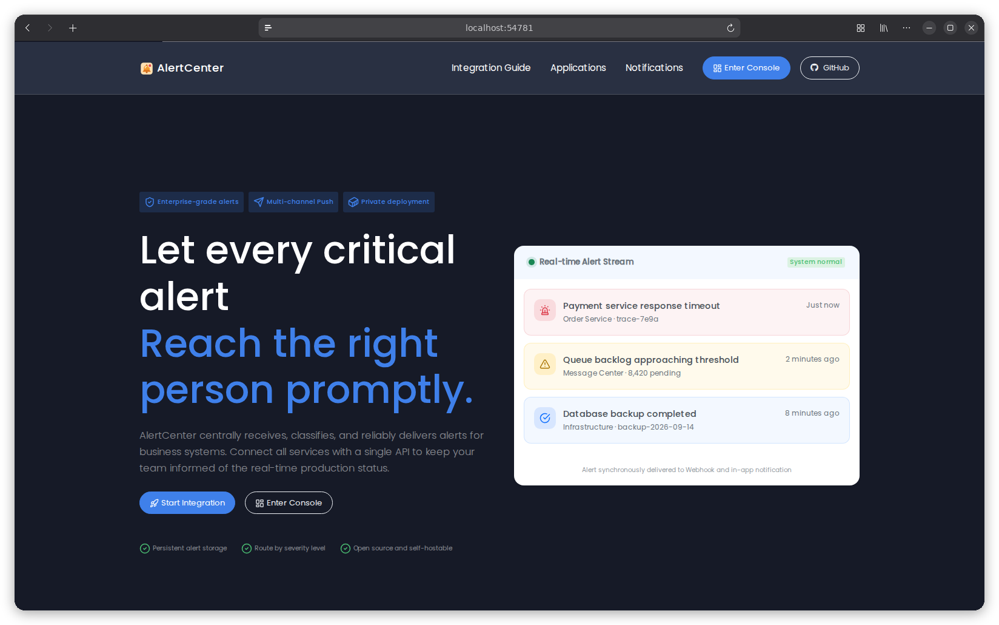

# AlertCenter

[](./LICENSE)
[](https://gitlab.aiursoft.com/aiursoft/alertcenter/-/pipelines)
[](https://gitlab.aiursoft.com/aiursoft/alertcenter/-/pipelines)
[](https://s360.aiursoft.com/SupplyChain?tab=projects&project=aiursoft%2Falertcenter&scope=baseline&ecosystem=all)
[](https://manhours.aiursoft.com/r/github.com/aiursoftweb/alertcenter.html)
[](https://hub.docker.com/r/aiursoft/alertcenter)

AlertCenter is a self-hosted alert management and notification platform built on ASP.NET Core (.NET 10). Business systems create incidents through one HTTP API; teams manage incidents, on-call schedules, and delivery through Webhook, email, and in-app notifications.

A native Android client supports incident browsing and response. See [Android app](docs/android.md) for authentication, building and installation.

## CLI & SDK

Install the CLI with the [.NET 10 SDK](https://dotnet.microsoft.com/download/dotnet/10.0):

```bash
dotnet tool install --global Aiursoft.AlertCenter.Client --add-source https://nuget.aiursoft.com/v3/index.json
```

Run `alertcenter --help` to explore commands. See [Integrations](#integrations) for authentication and usage.

Add the SDK to your .NET project:

```bash
dotnet add package Aiursoft.AlertCenter.SDK --source https://nuget.aiursoft.com/v3/index.json
```



On an empty database, the default local account is `admin@default.com` with password `Admin@123456!`. Change the password before exposing the application.

## What is AlertCenter?

- Independent API keys, idempotent reporting, and five severity levels (`sev0` through `sev4`).
- Independent incidents, acknowledgement, ownership, mitigation, resolution, and Markdown discussions.
- On-call teams, reusable scheduling templates that define shift splitting and rotation for automatic extension and one-click generation, and an interactive Gantt editor with coverage, overlap and rest reminders. Changing a template does not affect scheduled shifts.
- Severity-based notification routing, personal inboxes, and delivery history.
- Application owners grant users and roles access to incidents, API keys, and application settings. Platform permissions control application creation and shared on-call/push administration; application managers can bind any visible on-call team.
- SQLite for standalone use, MySQL support, and local or OIDC authentication through [Aiursoft Template](https://github.com/AiursoftWeb/template).

## Install with Docker

Run the installer with the desired port (omit it to choose an available port):

```bash
curl -fsSL https://raw.githubusercontent.com/aiursoftweb/alertcenter/master/install.sh | sudo bash -s -- 8080
```

Installation starts after three seconds; press Ctrl+C to cancel. Then open `http://localhost:8080`.

## Run manually

1. Install the .NET 10 SDK and Node.js/npm.
2. Prepare the frontend assets:

   ```bash
   npm ci --prefix src/Aiursoft.AlertCenter/wwwroot
   npm run build --prefix src/Aiursoft.AlertCenter/wwwroot
   ```

3. Start the application:

   ```bash
   dotnet run --project src/Aiursoft.AlertCenter
   ```

4. Open the URL printed by the application.

The defaults use SQLite and local accounts. Configure authentication, database, and storage through [appsettings.json](src/Aiursoft.AlertCenter/appsettings.json) or environment variables.

## Run in Microsoft Visual Studio

1. Prepare the frontend assets as described above.
2. Open `Aiursoft.AlertCenter.sln` and run the `Aiursoft.AlertCenter` project with `F5`.

## Run in Docker

```bash
image=aiursoft/alertcenter
appName=alertcenter
sudo docker pull $image
sudo docker run -d --name $appName --restart unless-stopped -p 5000:5000 -v /var/www/$appName:/data $image
```

Open `http://localhost:5000`. Keep `/data` persistent for configuration, the SQLite database, uploaded files, and Data Protection keys.

| Properties | Value |
| --- | --- |
| Image | aiursoft/alertcenter |
| Ports | 5000 |
| Binary path | /app |
| Data path | /data |
| Config path | /data/appsettings.json |

The image copies its default configuration to `/data/appsettings.json` on first start and retains that file on subsequent starts. Environment variables use double underscores, such as `ConnectionStrings__DefaultConnection` or `AppSettings__OIDC__ClientSecret`.

## Integrations

Create an application and API key in the web UI. Its **Integration Guide** provides HTTP API examples for your server.

Install the CLI or SDK using the [commands above](#cli--sdk).

The CLI can query and manage incidents, update metadata, and report GitLab pipeline results. Pass `--server` and `--api-key` with each command; use `alertcenter --help` to explore commands.

## Permissions and on-call response

Administrators with `CanManageOnCall` can delete a team even after automatic scheduling has created shifts. The confirmation shows future (including ongoing) and historical shift counts and requires the exact team name. Unbind every application first using the links shown on the team page. Deletion permanently removes the team's shifts, assignments, membership, fallback recipients and handover checkpoints/receipts, but not reusable templates, users, incident OCE snapshots or delivery records. It is serialized with schedule saving and background extension; a deleted team cannot be recreated by maintenance.

The console home shows every team's current OCEs, the next shift, and coverage gaps with fallback recipients (or a missing-fallback warning). Current recipients use the same `OnCallOceService` as incident routing, including merged overlapping shifts. Your active duty is highlighted and shown as an **On duty** navigation badge.

Open **Features → On-call → My on-call** (`/OnCall/Mine`) or the home card to see current duty and countdowns, the next eight weeks across teams, paginated history, and personal schedule reminders. Times show the team zone and browser-local time when different. The past 30 days and next four weeks count only covered time inside each window, merging overlaps so simultaneous duty is counted once.

On that page, generate a private iCal subscription covering the past 30 days and next 12 weeks. Copy the URL into a phone calendar subscription or Outlook's **Subscribe from web**. Only the SHA-256 hash of the random 256-bit token is stored; the URL is displayed once, and resetting immediately revokes the previous URL. Treat the link as a password. Set `Email:PublicBaseUrl` to the public site URL, including any deployment path prefix. Calendar entries have stable shift IDs, UTC times, team names and coworkers. Calendar clients control refresh timing. Application request/route diagnostics omit URL-level informational/debug logging to protect subscription tokens; configure reverse-proxy/access logs to omit the query string for `/OnCall/Calendar.ics` as well.

Platform capabilities use `Permission` claims. Roles collect permissions; the name `Administrators` does not grant privileges by itself.

- `CanManageApplications` permits creating applications. It does not bypass per-application ownership or user/role grants.
- `CanManageOnCall` permits managing teams, scheduling templates, and schedules. Saved shifts determine the current on-call engineers (OCEs); a template preview alone does not provide coverage.
- `CanManagePush` permits managing channels and sensitive delivery configuration. A user's channel binding access and recipient membership are separate; binding a channel also requires application manage access.

Only the application owner or users explicitly granted incident update permission may handle an incident. OCE duty and incident assignment do not grant access. A view grant alone does not permit incident handling. Default identity initialization runs only when both users and roles are empty; restarting an existing installation does not restore revoked permissions or grant newly introduced permissions.

Applications may bind an on-call team. Each new incident queues built-in email to that team's OCEs at `OccurredAtUtc`, independently of custom severity routes. The initial OCE roster and email addresses are snapshotted; later incident emails retain those recipients even after shift, membership, address or application team changes. Team CC configuration applies regardless of the shift and is captured for each delivery; retries retain that delivery’s recipient and CC snapshot. If the original group has been deleted, its captured CC list is retained. Correcting CC configuration permits later emails when the original OCE addresses are valid; failed delivery history and invalid original OCE addresses are not rewritten. The incident page shows this original roster separately from the current OCEs. ACK assigns the owner without changing the roster. Historical incidents without an original snapshot do not substitute the current OCE; when an on-call team is configured, a visible failed delivery explains the missing snapshot. Missing coverage or invalid recipient configuration produces a visible delivery failure without rejecting the alert. There are no automatic email retries; inspect delivery records before manually retrying an SMTP failure.

On-call shifts accept arbitrary UTC start/end times and zero or more team members. Coverage gaps, overlaps, empty shifts, departed members, short breaks and long continuous duty produce reminders, without preventing saves. Reminder thresholds belong to each team. Departing members retain their existing assignments. Schedule versions prevent concurrent overwrites.

Templates support minute-based fixed durations or weekly handover points in the team's time zone, a fixed headcount and an ordered rotation queue. Optional alternating pair swaps apply to even queues of at least four people. Enabled teams automatically append coverage through the next four weeks without changing existing shifts. Overlapping shifts merge recipients; gaps use configured fallback system users, recorded in the delivery snapshot. Newly arriving engineers receive a persisted, deduplicated unresolved-incident summary through the regular email delivery queue.

Team forms separate basic information, the numbered rotation queue, fallback recipients, scheduling method and collapsed advanced settings. Members and fallback users have independent searches; reorder the queue with its drag handles (hold before dragging on touch), arrow keys or Move up/down buttons. Binding a template previews four generated segments without changing saved shifts. Scheduling start times are entered in the team's time zone and stored in UTC: `GroupInput.AnchorLocal` is the new local input, while legacy `GroupInput.AnchorUtc` submissions retain UTC semantics. Weekly templates suggest the next first handover and offer other upcoming handovers; fixed-duration templates suggest the next local whole hour. Manual changes are not overwritten, off-handover starts only warn, and saved shifts lock the start point. Automatic extension requires a template. Reminder thresholds and notification CC remain in advanced settings.

The Gantt chart is the primary schedule editor, with one row per person and an unassigned row for empty shifts. Drag a shift's body to move its time or person, drop it onto another assigned shift to exchange members, drag either edge to resize it, drag a handover to adjust both adjoining shifts, or drag a blank member row to create a shift. Times snap to 30 minutes; hold Alt for minute precision. On touch screens, hold before dragging and use the time axis or chart background to scroll horizontally. Each active member's **Swap full week** button can be dragged to another member, or selected before selecting the target row, to exchange their assignments across the visible range. **Precise editing / bulk operations** is collapsed by default and provides the schedule table, a selected-shift move control, full-week member swaps, and range copying/generation. The exact-edit dialog supports arbitrary boundaries and zero or multiple assignees in the team's time zone. Undo, redo, reset and save remain visible.

With a shift focused, Left/Right moves time and Up/Down changes person; Shift + Left/Right adjusts its end and Shift + Up/Down adjusts its start. Enter opens exact editing, Delete removes the shift, and Escape cancels. Adjacent weeks and other teams remain read-only. The chart marks reminders and shows each person's duty hours clipped to the displayed range, merging overlapping assignments. Week navigation follows the team's configurable first weekday (Monday by default), including DST changes; a custom range is available to all signed-in viewers. Only users with `CanManageOnCall` see editing controls and instructions.

Copy repeats the current draft into a destination range using local calendar time, clipping shifts at the destination boundaries; destinations may replace exactly the visible range or an existing copied range, but must not partially overlap either. Template generation and copying preview existing intersecting shifts before confirming **draft replacement**; each intersecting shift is replaced in full. All edits, generated shifts and copied ranges remain drafts until **Save schedule adjustments** publishes them; undo, redo and reset also include copied drafts. Unpublished changes do not affect notification recipients. Team forms configure nullable reminder thresholds, fallback users and automatic extension; template forms include weekly handover points and the eight-hour preset.

`GetSchedule` returns the saved shift IDs, full UTC boundaries (including shifts crossing the requested week), members and reminders. `SaveSchedule` accepts arbitrary `slots` with `id`, `startsAtUtc`, `endsAtUtc` and `userIds`; an omitted end retains the legacy eight-hour request format. Requests can instead supply minute-precision `startLocal` / `endLocal` for both the range and each slot; the server converts them with the team's time zone. Skipped DST times are rejected and repeated times use standard time. The replacement range defaults to seven local calendar days from `startUtc`, with optional `endUtc`. `PreviewSchedule` validates a draft without writing; `?generate=true` previews template generation and returns `replacedSlots`, generated `slots` and located `timelineWarnings`. Generation requires `confirmReplace: true` and the current `version` when existing shifts intersect the range. Team form fields under `GroupInput` include `WeekStartsOn`, nullable `MinimumRestHours`, `MaximumContinuousHours`, `MinimumShiftStaff`, `FallbackUserIds` and `AutoExtend`; template fields under `RuleInput` include `SplitMode`, `ShiftMinutes`, `StaffPerShift`, `SwapAlternateRounds` and `HandoverPoints` (`DayOfWeek`, `MinuteOfDay`). Weekly template handovers shift nonexistent DST times forward to the first valid minute and choose standard time for ambiguous times.

## Configuration

See the comments in [appsettings.json](src/Aiursoft.AlertCenter/appsettings.json) for database, storage, authentication, and logging settings. Keep secrets in protected environment variables.

- **OIDC:** set `AppSettings__AuthProvider=OIDC` and the `AppSettings__OIDC__*` values. Register the application's HTTPS `/signin-oidc` callback with your identity provider and assign the required application permissions.
- **Email:** configure `Email__Host`, `Email__Port`, `Email__From`, and, when required, `Email__UserName` and `Email__Password`. STARTTLS is enabled by default. Both custom channels and built-in on-call email use these settings. Emails include HTML and plain-text alternatives with a direct incident link. Incident email is sent for creation (red), mitigation (yellow), resolution (green), and reopening (red). Each successful transition queues an email, including repeated mitigation and resolution after reopening. Mitigate-and-resolve sends only the green resolution email. Acknowledgement, reassignment, comments, and severity changes do not send email; API resolution follows the same rules. Set `Email__PublicBaseUrl` to your public site address (including any path prefix); it defaults to `https://alertcenter.aiursoft.com`.
- **Webhook:** custom encrypted request headers require `Webhook__HeaderProtectionKey`, a Base64-encoded 32-byte key generated with `openssl rand -base64 32`. Preserve this key: losing or changing it makes saved custom headers unreadable. Without it, default headers and custom JSON body templates remain available.

### Database migrations

The multiple-key migration removes the old application-level secret hash without migrating credentials. Create new scoped keys and update integration configuration after upgrading. EmployeeCenter audit synchronization needs query, create and resolve permissions.

The application applies pending migrations at startup. Generate future migrations for both providers using the [SQLite guide](src/Aiursoft.AlertCenter.Sqlite/HOW_TO_ADD_MIGRATIONS.md) and [MySQL guide](src/Aiursoft.AlertCenter.MySql/HOW_TO_ADD_MIGRATIONS.md).

## How to contribute

Report bugs and suggestions through the issue tracker. Create a fork and a feature branch, then submit a merge request for review.

After preparing frontend assets, run the existing checks:

```bash
dotnet test tests/Aiursoft.AlertCenter.Tests.csproj
node --test tests/Frontend/*.test.cjs
./lint.sh
```

### Application sharing

An application owner has every application permission. Sharing grants independent permissions to users or roles: view, create, update incidents (including comments and status), manage API keys, permanently delete incidents, and manage application settings/sharing. Direct and role grants are combined. Updating or deleting incidents also requires view access. Application creation uses the existing platform permission; platform permissions, incident assignment, and on-call duty do not grant access to another application's incidents.

Only the owner can transfer ownership or delete the application. Sharing managers cannot grant permissions they do not have. Permanent incident deletion requires its exact title and current version. Existing explicit view/manage grants are preserved by the migration; older applications have no inferred owner and need an explicit ownership assignment before owner-only operations. Owner accounts must transfer their applications before deletion.

Each application owns multiple API keys. Owners and users/roles granted API key management can list, create, edit and delete its keys; newly granted key permissions cannot exceed the manager's application permissions. Keys authenticate as `<applicationId>.<keyId>.<secret>` and cannot access another application. The key list shows persistent authenticated-call totals and last-use timestamps (UTC). Counts include permission denials and business failures after valid input/authentication, but exclude malformed requests and invalid credentials.

Applications can change an active incident severity through `POST /api/v1/incidents/{incidentId}/severity` or SDK `ChangeIncidentSeverityAsync`. Supply the queried `Version`, a `Level` from `sev0` to `sev4`, and a `Reason`. This requires the separate **Change incident severity** API key scope (disabled on existing keys). Changes are application-scoped, concurrency-checked and recorded in the timeline without sending email. SDK version: `10.3.0`.

SDK 10.8.0 adds `ReopenIncidentAsync` (`POST /api/v1/incidents/{incidentId}/reopen`) with the independent **Reopen incidents** key scope, disabled on existing keys. Supply the queried `Version` and a `Reason`; query/detail responses include `MitigatedAtUtc` and `ResolvedAtUtc`. Set `RecoveredSinceUtc` to query open incidents plus recovery history since a UTC cutoff.

Acknowledgement is independent of incident progress (`new`, `mitigated`, `resolved`).
Any authorized user may acknowledge repeatedly; each acknowledgement assigns the
incident to that user without changing its progress. `AcknowledgedAtUtc` is the
latest acknowledgement time, and `IsAcknowledged` reports whether it has ever
been acknowledged. Reopening preserves acknowledgement and ownership. SDK 10.6.0
query/detail responses also expose these fields and the current owner. Legacy
`status=acked` web links select acknowledged incidents across all progress states;
use `acknowledged=true` or `false` to combine confirmation with a progress filter.

The dashboard links to **My incidents** (`/Incidents/Mine`), showing incidents whose current owner is the signed-in user, within that user's accessible applications. Status, severity, acknowledgement, keyword and date filters remain available; pagination retains the personal scope. Ownership does not grant application access.
